<div align="center">



### Practical digital solutions, designed around real business requirements.

[](https://www.facebook.com/share/1JoirX71tD/)
[](https://www.instagram.com/nk_digital_craft)
[](https://www.youtube.com/@nkdigitalcraft)
[](mailto:nkbusinessout@gmail.com)

</div>

---

## About NK Digital Craft

**NK Digital Craft** helps businesses build a professional online presence. We combine modern websites, UI/UX design, SEO, digital marketing, AI and automation into one practical approach, so every project is built around what your business actually needs and how it grows customers.

Our goal is simple: **help every business reach the right customers and grow online.**

**Founder & CEO:** Nikhil Kumar Singh

---

## What We Do

| Service | What You Get |
|---|---|
| **Website Development** | Fast, responsive, modern websites built to convert visitors into customers |
| **UI/UX Design** | Clean interfaces and user journeys that are easy to use and look premium |
| **SEO** | Search-friendly structure and content strategy to get found on Google |
| **Digital Marketing** | Campaigns and content that bring the right audience to your business |
| **AI & Automation** | Smart workflows and AI tools that save time and reduce manual work |

---

## Our Approach

```text
Understand the business  →  Design the experience  →  Build & automate  →  Launch & grow
```

1. **Discover**: We learn your goals, audience, and what is slowing your business down.
2. **Design**: We plan the structure, visuals, and user journey before writing code.
3. **Build**: We develop with clean, maintainable code and automate where it adds value.
4. **Grow**: We support launch, measure results, and improve over time.

---

## Tech Stack

<div align="center">


</div>

---

## Work With Us

Have a project in mind, or want to see how AI and automation can help your business?

- **Email:** [nkbusinessout@gmail.com](mailto:nkbusinessout@gmail.com)
- **Instagram:** [@nk_digital_craft](https://www.instagram.com/nk_digital_craft)
- **YouTube:** [@nkdigitalcraft](https://www.youtube.com/@nkdigitalcraft)
- **Facebook:** [NK Digital Craft](https://www.facebook.com/share/1JoirX71tD/)

---

## GitHub Stats

<div align="center">


</div>

---

<div align="center">

**© NK Digital Craft.** Crafted with care in code and design.

[](https://visitcount.itsvg.in)

</div>
